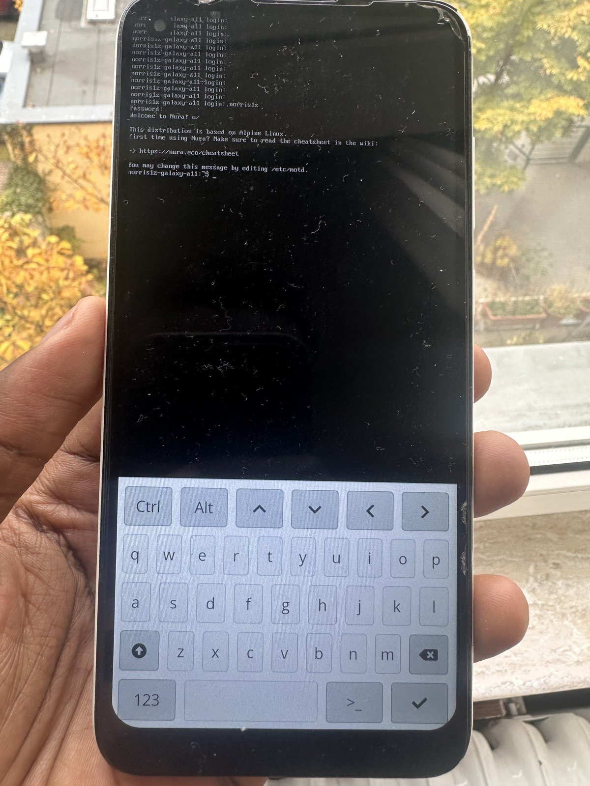
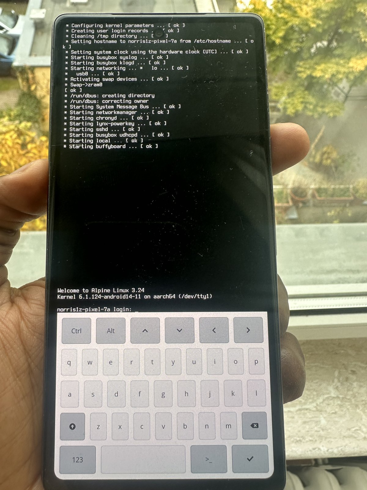
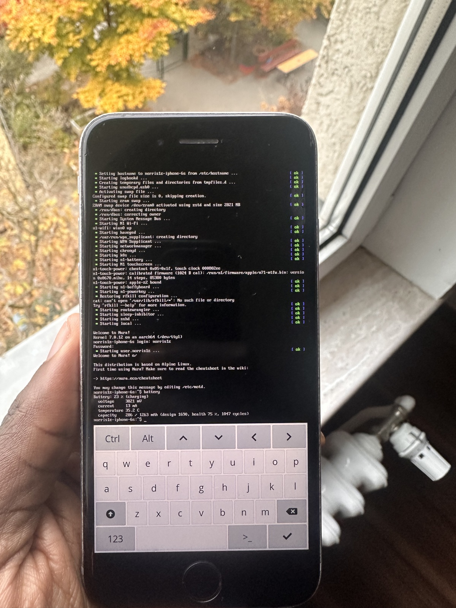
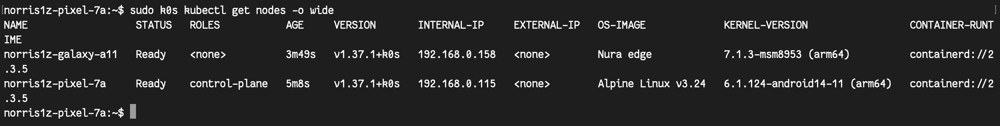

# Phonelab

Inspired by Google's [low-carbon computing platform from retired phones](https://research.google/blog/a-low-carbon-computing-platform-from-your-retired-phones/),
I wanted to see whether it's even possible to run Kubernetes on mobile phones.

All three phones run headless Linux, like small servers: no Android or iOS, no desktop,
just a console login on the screen and SSH.

I started with a Samsung Galaxy A11, installing Nura (postmarketOS), and ended up
running a mainline Linux 7.1 kernel on it, with my own device tree and drivers
for the phone.

The second device is a Google Pixel 7a. Its chip (Tensor G2) has no usable
mainline kernel support, so it runs Google's own Android kernel (6.1), rebuilt
with the features Kubernetes needs, with Alpine Linux on top instead of
Android.

The third device is an iPhone 6s running Nura on Linux 7.0 (it only boots while
tethered to my Mac via the checkm8 exploit). To get it working, I had to write
a PCIe host bridge driver for its A9 chip (for Wi-Fi and the internal NVMe
storage), patch the kernel's NVMe driver for Apple's storage controller, and add
touchscreen, battery and Wi-Fi support to its device tree.

<table>
  <tr>
    <td align="center"></td>
    <td align="center"></td>
    <td align="center"></td>
  </tr>
  <tr>
    <td align="center">Galaxy A11: Nura, mainline Linux 7.1</td>
    <td align="center">Pixel 7a: Alpine Linux, Google's kernel 6.1</td>
    <td align="center">iPhone 6s: Nura, Linux 7.0</td>
  </tr>
</table>

All phones in one k0s cluster, on Wi-Fi, with the Pixel as the control plane:

